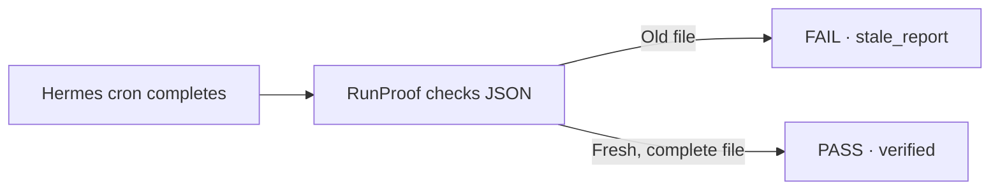

# RunProof

**Verify the report behind a successful Hermes cron run.**

A cron job can exit successfully while yesterday's JSON report stays on disk. RunProof compares the report with the recorded execution window, checks required fields, and returns a JSON verdict and exit code for downstream automation.



## Run the demo

With Hermes Agent 0.23.0 and Python 3.11+ on PATH on macOS or Linux:

```sh
git clone https://github.com/Biznomad/runproof.git
cd runproof
./demo.py --state-dir "$(mktemp -d)"
```

The demo installs and enables RunProof in a disposable Hermes home. It creates four one-shot schedules and invokes the real scheduler tick after each due time. Follow the terminal or open the checkpoint and receipts in the printed directory. Ctrl-C pauses the demo. Reuse the same directory to resume. Running `./demo.py` without arguments uses `.demo/local/`.

Observed on Hermes v0.23.0 with four real one-shot schedules and a synthetic order report.

| Hermes cron | RunProof | Evidence |
| --- | --- | --- |
| completed | FAIL | Old JSON was left in place |
| completed | FAIL | Fresh JSON omitted `summary` |
| completed | PASS | Fresh JSON populated all required fields |
| completed | PASS | A second corrected execution produced the same bytes |

## Install into a Hermes home

Set the target to the intended Hermes profile directory before installing:

```sh
export HERMES_HOME=/absolute/path/to/hermes-home
mkdir -p "$HERMES_HOME/plugins/runproof"
cp plugin.yaml __init__.py "$HERMES_HOME/plugins/runproof/"
hermes plugins enable runproof
hermes runproof --help
```

After the producing cron job has finished, run the verifier with the exact job ID:

```sh
hermes runproof JOB_ID /absolute/path/to/report.json \
  --require report_id --require orders --require summary
```

RunProof emits one JSON object and exits 0 for PASS or 1 for FAIL. It requires a completed latest execution, a regular file of at most 1 MiB written within the execution window, and populated top-level fields. Empty strings, whitespace, nulls, empty arrays and empty objects fail. Zero and false are valid values. A PASS includes the execution ID, timestamps and SHA-256 of the bytes checked.

The verifier uses filesystem modification time as freshness evidence. It checks field presence and population. A writer with access to the report and its timestamps can forge that evidence, and simultaneous writers should use separate report paths. The integration uses Hermes's `cron.executions.latest_execution` helper, verified on v0.23.0. The plugin runs on demand as a CLI gate.

## Permissions and local data

The installed CLI reads the active Hermes profile's cron execution history and the report path supplied by the operator. It makes zero network calls and starts zero subprocesses. The optional demo invokes the local Hermes CLI and writes synthetic reports and execution state to its isolated directory. RunProof is MIT-licensed.

[Hermes plugin guide](https://hermes-agent.nousresearch.com/docs/developer-guide/plugins) · [Hermes cron guide](https://hermes-agent.nousresearch.com/docs/user-guide/features/cron)
