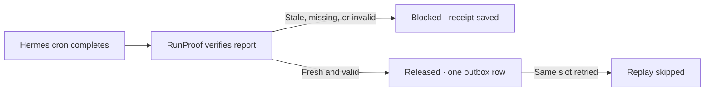

# RunProof

**Gate downstream work on the report behind a successful Hermes cron run.**

A producer can exit successfully while yesterday’s JSON stays on disk. RunProof checks Hermes’s execution record and the report, records a verdict, and releases the exact verified bytes to a local SQLite outbox once per workflow slot.



## Quickstart

Use Hermes Agent v0.23.0 and Python 3.11+ on macOS or Linux.

```sh
git clone https://github.com/Biznomad/runproof.git
cd runproof
./demo.py --state-dir "$(mktemp -d)"
```

The demo schedules four real Hermes one-shot jobs in an isolated home and ticks the scheduler after each due time. All four producers complete.

| Evidence | Gate | Outbox rows |
| --- | --- | --- |
| Yesterday’s report | Blocked · `stale_report` | 0 |
| Fresh JSON missing a required field | Blocked · `unpopulated_fields` | 0 |
| Corrected report | Released | 1 |
| Same execution retried, then another run for the same slot | Replay skipped | 1 |

An independent check reads the ledger and hashes its payload. The demo writes its checkpoint and receipts to the printed directory. Rerun with the same directory to resume.

## Install and gate a report

Set `HERMES_HOME` to the intended profile before installing.

```sh
export HERMES_HOME=/absolute/path/to/hermes-home
mkdir -p "$HERMES_HOME/plugins/runproof"
cp plugin.yaml __init__.py "$HERMES_HOME/plugins/runproof/"
hermes plugins enable runproof
hermes runproof --help
```

After the producer finishes, verify and release one report. Choose a stable key for the logical slot and reuse it if the producer needs a retry.

```sh
hermes runproof JOB_ID /absolute/path/to/report.json \
  --require report_id --require orders --expect-true checks_ok \
  --ledger /absolute/private/path/gate.sqlite --key daily-orders:2026-11-07
```

The verifier uses the latest Hermes execution for that job by default. Supply `--execution EXECUTION_ID` to pin an exact attempt. The attempt must belong to the specified job and have completed. The report must be a regular JSON object of at most 1 MiB, written inside the execution window. Required fields must be populated. Zero and false count as populated. `--expect-true` specifically requires JSON `true`. Omit `--ledger` and `--key` for a verification-only receipt.

## Retries and downstream consumption

- **Blocked** returns exit 1 with an actionable reason. Fix and rerun the producer, then retry the same key, report path, and field policy. The retry can have a different execution ID.
- **Released** returns exit 0 and atomically commits the receipt and payload. **Replay skipped** also returns exit 0 after successful verification and identifies the original release. Both decisions preserve a single outbox row. Treat the outbox as the input to downstream work.
- A consumer reads `release_key`, `execution`, `sha256`, and `payload` from `outbox`, using `release_key` as its idempotency key. Concurrent gate invocations serialize through SQLite. External side effects need their own idempotent consumer.
- Use one ledger in an operator-owned directory on a local filesystem. On a ledger error, the CLI returns exit 1 with `gate=unknown`. Retry the same key after checking permissions or contention. Keep the database for deduplication and use a fresh key for each new logical slot.

The receipt ties the hashed snapshot to the recorded job and execution window. Freshness relies on filesystem timestamps and a dedicated producer-owned report path. Treat writers with access to that path or its timestamps as trusted.

## Local data and compatibility

The installed CLI reads cron history and the supplied report, and writes the optional ledger, including full accepted report bytes. Keep the ledger and its SQLite sidecars private. The plugin makes zero network calls and starts zero subprocesses. The demo starts local Hermes subprocesses and writes to its isolated directory.

Hermes v0.23.0 was tested. The CLI uses the public registration API and internal cron history helpers. Hermes’s validator reports those helpers as a compatibility advisory. Run `python3 -m unittest -v test_gate` for concurrent release, blocked evidence, and transaction rollback checks.

[Hermes plugin guide](https://hermes-agent.nousresearch.com/docs/developer-guide/plugins) · [Hermes cron guide](https://hermes-agent.nousresearch.com/docs/user-guide/features/cron) · [MIT license](LICENSE)
